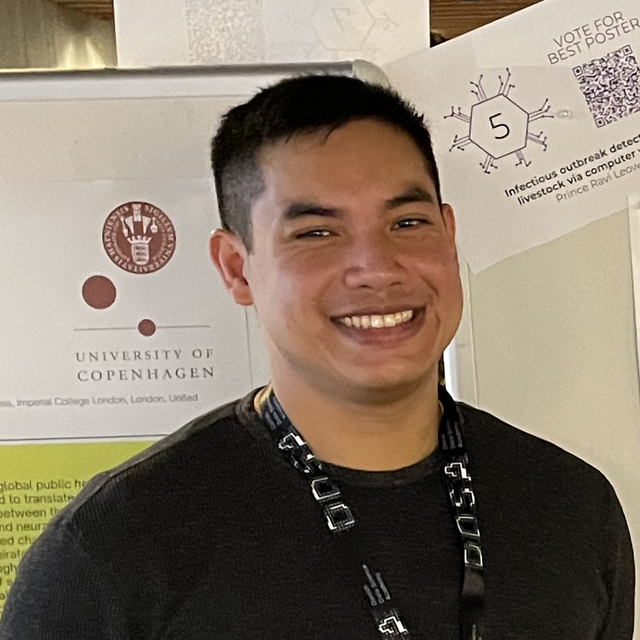

::::::: {.home}

::::: {.masthead}
{.avatar fig-alt="Prince Ravi Leow standing next to a research poster"}

:::: {.identity}
# Prince Ravi Leow

::: {.role}
PhD student @ Section for Health Data Science & AI (University of Copenhagen)
:::

::: {.links}
[<i class="bi bi-person-vcard"></i> CV](assets/cv.pdf)
[<i class="bi bi-envelope"></i> Email](mailto:prince.leow@sund.ku.dk)
[<i class="bi bi-github"></i> GitHub](https://github.com/prince-ravi-leow)
[<i class="bi bi-linkedin"></i> LinkedIn](https://www.linkedin.com/in/prince-ravi-leow)
[<i class="bi bi-mortarboard"></i> [Google]{.wide-only} Scholar](https://scholar.google.com/citations?user=v0wjZzoAAAAJ&hl=en)
[<svg class="bi" xmlns="http://www.w3.org/2000/svg" viewBox="0 0 256 256" width="1em" height="1em" fill="currentColor" fill-rule="evenodd" aria-hidden="true"><path d="M256,128c0,70.7-57.3,128-128,128C57.3,256,0,198.7,0,128C0,57.3,57.3,0,128,0C198.7,0,256,57.3,256,128z M86.3,186.2H70.9V79.1h15.4v48.4V186.2z M108.9,79.1h41.6c39.6,0,57,28.3,57,53.6c0,27.5-21.5,53.6-56.8,53.6h-41.8V79.1z M124.3,172.4h24.5c34.9,0,42.9-26.5,42.9-39.7c0-21.5-13.7-39.7-43.7-39.7h-23.7V172.4z M88.7,56.8c0,5.5-4.5,10.1-10.1,10.1c-5.6,0-10.1-4.6-10.1-10.1c0-5.6,4.5-10.1,10.1-10.1C84.2,46.7,88.7,51.3,88.7,56.8z"/></svg> ORCID](https://orcid.org/0009-0008-8997-2020)
:::
::::
:::::

::: {.lede}
I build computer vision systems that measure animal behaviour and health at scale.
:::

```{=html}
<figure class="hero-video">
  <video autoplay loop muted playsinline controls
    aria-label="Three synchronised panels of broiler chicks in a pen: raw video, optical flow, and SAM 3.1 tracks of individual birds"
    data-wide="assets/flow_vs_tracks_horiz.mp4" data-tall="assets/flow_vs_tracks_vert.mp4"></video>
</figure>
<script>
  (() => {
    const video = document.querySelector(".hero-video video");
    const narrow = window.matchMedia("(max-width: 700px)");
    const pick = () => {
      video.src = narrow.matches ? video.dataset.tall : video.dataset.wide;
    };
    pick();
    narrow.addEventListener("change", pick);
  })();
</script>
```

## Selected work

:::: {.tracks}

::: {.track .track-blue}
[CVPR 2026 workshop]{.track-id}

### [PlayClass](https://github.com/sbhattlab/PlayClass)

A computer vision pipeline that classifies play behaviour in poultry from video. Presented at the [CV4Animals Workshop @ CVPR 2026](https://www.cv4animals.com/) ([paper](https://doi.org/10.48550/arXiv.2605.27304)) and featured in [GitHub Octoverse 2026](https://github.blog/news-insights/octoverse/octoverse-commits-pushes-reach-new-highs-in-2026-as-developers-build-with-agents/). A manuscript is under review at PLOS One.
:::

::: {.track .track-peach}
[Royal Society Open Science 2025]{.track-id}

### [Detecting infection from video](https://doi.org/10.1098/rsos.250151)

We showed that deep learning on ordinary video can measure *E. coli* infection in broiler chickens ([Royal Society Open Science, 2025](https://doi.org/10.1098/rsos.250151)). A talk on this work won [Best Lightning Talk at Health Data Science Day 2025](https://lnkd.in/p/exNUscXH).

:::

::::

## Writing

:::: {.tracks}

::: {.track .track-lime}
[Newsletter]{.track-id}

### [A Byte Of Health](https://byteofhealth.substack.com/)

A newsletter on health and life science breakthroughs.
:::

::: {.track .track-blue}
[Notes]{.track-id}

### [Notes on Quarto Pub](https://prince-ravi-leow.quarto.pub/)

Occasional longer pieces.
:::

::::

:::::::
